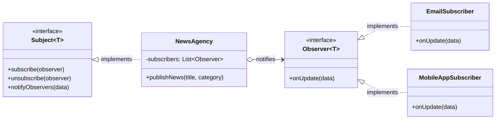
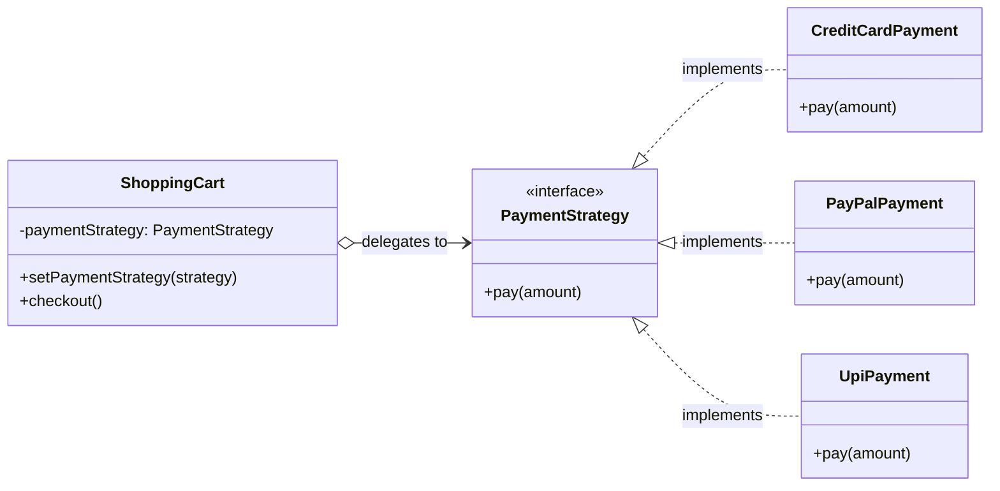

# Behavioral Design Patterns in Kotlin

Package: `design.pattern.behavioral`

---

## 1. What are Behavioral Design Patterns?

While **Creational patterns** deal with how objects are instantiated and **Structural patterns** manage how classes and objects are composed, **Behavioral Design Patterns** are concerned with **algorithms and the assignment of responsibilities between objects**.

They describe not just patterns of objects or classes, but the **patterns of communication** between them.

### Core Problems They Solve:
1. **Tight Coupling in Communication**: When objects need to respond to state changes or notify others, hardcoded direct calls make the code inflexible and hard to extend.
2. **Rigid Algorithm Selection**: Hardcoding business rules or calculation algorithms into client classes violates the Open/Closed Principle.
3. **Irreversible Operations & Lack of Request History**: Managing transactional operations, command queues, and Undo/Redo mechanisms without duplicating state.

### Architectural Principles Applied:
- **Decoupled Senders and Receivers**: Senders invoke operations without needing to know who handles them or how.
- **Single Responsibility Principle (SRP)**: Isolate business algorithms or action invocations into dedicated units.
- **Open/Closed Principle (OCP)**: Introduce new observers, strategies, or commands without modifying existing invoker/subject code.

---

## 2. Pattern 1: Observer Pattern

### Intent
Define a **one-to-many dependency** between objects so that when one object changes state, all its registered dependents are notified and updated automatically.

### Real-World Analogy
A **YouTube Channel** or **Newspaper Subscription**:
- Subscribers register to follow a channel (*Subject*).
- When a new video is published, the platform broadcasts a notification to all subscribers.
- Subscribers can join (*subscribe*) or leave (*unsubscribe*) at any time without disrupting the channel.

### Architecture & Kotlin Implementation



#### A. Classic Subject-Observer
```kotlin
interface Observer<T> {
    fun onUpdate(data: T)
}

interface Subject<T> {
    fun subscribe(observer: Observer<T>)
    fun unsubscribe(observer: Observer<T>)
    fun notifyObservers(data: T)
}

class NewsAgency : Subject<NewsArticle> {
    private val subscribers = mutableListOf<Observer<NewsArticle>>()

    override fun subscribe(observer: Observer<NewsArticle>) { subscribers.add(observer) }
    override fun unsubscribe(observer: Observer<NewsArticle>) { subscribers.remove(observer) }
    override fun notifyObservers(data: NewsArticle) {
        subscribers.forEach { it.onUpdate(data) }
    }
}
```

#### B. Idiomatic Kotlin: `Delegates.observable`
For lightweight property-level observation, Kotlin's standard library provides built-in property delegates:
```kotlin
import kotlin.properties.Delegates

class StockTicker(val symbol: String) {
    var price: Double by Delegates.observable(0.0) { property, oldPrice, newPrice ->
        println("[StockTicker: $symbol] Changed: \$$oldPrice -> \$$newPrice")
    }
}
```

### When to Use
- When a change to one object requires changing others, and you do not know how many objects need to change.
- UI state updates, event bus messaging, Reactive programming (StateFlow / SharedFlow in modern Android/Kotlin).

### When to Avoid
- When subscriber order matters, or when memory leaks occur due to forgotten `unsubscribe()` calls (the "lapsed listener" problem).

👉 **Source Code**: [ObserverPattern.kt](ObserverPattern.kt)

---

## 3. Pattern 2: Strategy Pattern

### Intent
Define a family of algorithms, encapsulate each one, and make them **interchangeable at runtime**. Strategy lets the algorithm vary independently from the clients that use it.

### Real-World Analogy
A **GPS Navigation App** or **E-Commerce Payment**:
- A maps application offers multiple route calculation strategies to the same destination: Driving (fastest road), Walking (pedestrian pathways), or Cycling (bike trails).
- An e-commerce cart accepts different payment strategies: Credit Card, PayPal, or UPI.

### Architecture & Kotlin Implementation



#### A. Classic OOP Strategy
```kotlin
interface PaymentStrategy {
    fun pay(amount: Double)
}

class CreditCardPayment(private val cardNumber: String) : PaymentStrategy { /*...*/ }
class UpiPayment(private val upiId: String) : PaymentStrategy { /*...*/ }

class ShoppingCart(private var paymentStrategy: PaymentStrategy) {
    fun setPaymentStrategy(newStrategy: PaymentStrategy) {
        this.paymentStrategy = newStrategy
    }
    fun checkout() {
        paymentStrategy.pay(total)
    }
}
```

#### B. Idiomatic Kotlin: Function Types & Lambdas
In Kotlin, functions are first-class citizens. Instead of creating an interface and multiple subclasses for simple calculation rules, you can pass a lambda `(Double) -> Double`:

```kotlin
typealias DiscountStrategy = (Double) -> Double

val noDiscount: DiscountStrategy = { price -> price }
val percentageDiscount: (Double) -> DiscountStrategy = { pct -> { price -> price * (1.0 - pct / 100.0) } }

class ProductPricing(val originalPrice: Double) {
    fun calculateFinalPrice(strategy: DiscountStrategy): Double = strategy(originalPrice)
}

// Client usage:
val price = product.calculateFinalPrice(percentageDiscount(20.0))
```

### When to Use
- When you want to use different variants of an algorithm within an object and be able to switch from one algorithm to another during runtime.
- When you have a massive conditional statement (`when` / `if-else`) that switches between different behaviors of the same algorithm.

### When to Avoid
- If you only have a couple of algorithms that rarely change, introducing strategies adds unnecessary abstraction overhead.

👉 **Source Code**: [StrategyPattern.kt](StrategyPattern.kt)

---

## 4. Pattern 3: Command Pattern

### Intent
Encapsulate a request as an object, thereby letting you parameterize clients with different requests, queue or log requests, and support **undoable operations**.

### Real-World Analogy
A **Restaurant Waiter's Order Pad** or a **Smart Home Remote**:
- When you place an order, the waiter writes it on an order slip. The slip is an object holding all details. It can be queued, passed to the cook, or cancelled.
- On a universal smart home remote control, buttons trigger encapsulated commands. A remote with an **"Undo" button** can reverse the last executed action.

### Architecture & Kotlin Implementation

```mermaid
flowchart LR
    Invoker["Invoker (SmartRemoteControl)\n- undoHistory: Stack\n- redoHistory: Stack"] -->|executes & tracks| Command["Command Interface\n+execute()\n+undo()"]
    Command <|.. C1["LightOnCommand"]
    Command <|.. C2["SetAcTempCommand"]
    Command <|.. C3["MacroCommand"]
    C1 -->|calls| Receiver1["Receiver: SmartLight\n- turnOn()\n- turnOff()"]
    C2 -->|calls| Receiver2["Receiver: AirConditioner\n- setTemp()"]
```

```kotlin
interface Command {
    fun execute()
    fun undo()
}

// Concrete Command
class SetAcTemperatureCommand(
    private val ac: AirConditioner,
    private val targetTemp: Int
) : Command {
    private var previousTemp: Int = ac.temperature

    override fun execute() {
        previousTemp = ac.temperature
        ac.setTemp(targetTemp)
    }

    override fun undo() {
        ac.setTemp(previousTemp)
    }
}

// Invoker with Undo/Redo Stacks
class SmartRemoteControl {
    private val undoHistory = Stack<Command>()
    private val redoHistory = Stack<Command>()

    fun executeCommand(command: Command) {
        command.execute()
        undoHistory.push(command)
        redoHistory.clear()
    }

    fun pressUndo() {
        if (undoHistory.isNotEmpty()) {
            val cmd = undoHistory.pop()
            cmd.undo()
            redoHistory.push(cmd)
        }
    }
}
```

### When to Use
- When you need to parameterize objects with operations (action-driven UI buttons, hotkeys).
- When you need to support **Undo / Redo** histories (e.g., text editors, graphics tools, configuration resets).
- When you want to queue operations, schedule their execution, or run them remotely across network threads.

### When to Avoid
- When operations are simple, synchronous, and do not need queuing, logging, or rollback capability.

👉 **Source Code**: [CommandPattern.kt](CommandPattern.kt)

---

## 5. Disambiguation Matrix: Observer vs Strategy vs Command

| Pattern | Primary Focus | Communication Style | Core Capability |
| :--- | :--- | :--- | :--- |
| **Observer** | State Synchronization | 1-to-Many broadcast | Subscribers react automatically when Subject changes. |
| **Strategy** | Algorithmic Interchangeability | 1-to-1 interchangeable delegation | Changes **how** a task is done at runtime (e.g., payment, sorting). |
| **Command** | Action Encapsulation & Lifecycle | 1-to-1 encapsulated request object | Decouples sender and receiver; supports **Undo/Redo**, queuing, and batch macros. |

---

## 6. Complete 3-Category Master Table

| Category | Pattern | Problem Addressed | Kotlin File |
| :--- | :--- | :--- | :--- |
| **Creational** | **Singleton** | Single instance guarantee with global access | [`SingletonPattern.kt`](../creational/SingletonPattern.kt) |
| **Creational** | **Factory** | Decoupled object instantiation logic | [`FactoryPattern.kt`](../creational/FactoryPattern.kt) |
| **Creational** | **Builder** | Step-by-step assembly of complex objects | [`BuilderPattern.kt`](../creational/BuilderPattern.kt) |
| **Structural** | **Adapter** | Bridging two incompatible interfaces | [`AdapterPattern.kt`](../structural/AdapterPattern.kt) |
| **Structural** | **Decorator** | Dynamically adding behaviors via `by` delegation | [`DecoratorPattern.kt`](../structural/DecoratorPattern.kt) |
| **Structural** | **Facade** | Simplifying complex multi-subsystem workflows | [`FacadePattern.kt`](../structural/FacadePattern.kt) |
| **Behavioral** | **Observer** | One-to-many event notification | [`ObserverPattern.kt`](ObserverPattern.kt) |
| **Behavioral** | **Strategy** | Interchangeable algorithms & functional lambdas | [`StrategyPattern.kt`](StrategyPattern.kt) |
| **Behavioral** | **Command** | Encapsulated requests with Undo/Redo history | [`CommandPattern.kt`](CommandPattern.kt) |

---

## How to Run the Examples
Each pattern file contains a standalone, runnable `fun main()`:
1. Open the file in your IDE (IntelliJ IDEA / Android Studio).
2. Click the green **Run** arrow next to `fun main()`.
3. Test event subscriptions, payment strategy swapping, and remote control Undo/Redo commands.
