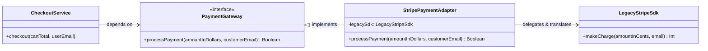
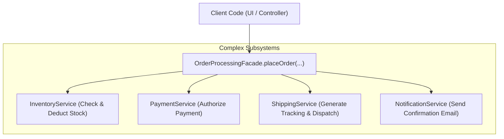

# Structural Design Patterns in Kotlin

Package: `design.pattern.structural`

---

## 1. What are Structural Design Patterns?

**Structural Design Patterns** focus on **how classes and objects are composed** to form larger, more flexible, and efficient structures. While creational patterns manage how things are instantiated, structural patterns organize relationships and interfaces between existing objects.

### Core Problems They Solve:
1. **Interface Incompatibility**: Third-party libraries or legacy services often have interfaces that cannot directly communicate with your application without modification.
2. **Rigid Class Hierarchies**: Over-relying on inheritance creates brittle code, combinatorial class explosions, and inflexible compile-time couplings.
3. **Subsystem Over-Complexity**: When an application grows, coordinating multiple interdependent subsystems exposes clients to unnecessary low-level details.

### Architectural Principles Applied:
- **Favor Composition Over Inheritance**: Dynamically assemble behaviors at runtime instead of locking them into static class trees.
- **Single Responsibility Principle (SRP)**: Keep business logic, transformation logic, and subsystem orchestration cleanly separated.
- **Open/Closed Principle (OCP)**: Introduce new wrappers or adapters without altering existing working code.

---

## 2. Pattern 1: Adapter Pattern

### Intent
Convert the interface of a class into another interface that clients expect. It allows classes with **incompatible interfaces** to collaborate without changing their underlying source code.

### Real-World Analogy
A **Travel Power Plug Adapter** or **USB-C to 3.5mm Headphone Jack Dongle**:
- Your laptop only exposes a **USB-C port** (*Target interface*).
- Your studio headphones terminate in a **3.5mm audio jack** (*Adaptee*).
- An adapter plugs between the two to translate electrical pinouts without modifying either the laptop or the headphones.

### Architecture & Kotlin Implementation



```kotlin
// Modern Target Interface
interface PaymentGateway {
    fun processPayment(amountInDollars: Double, customerEmail: String): Boolean
}

// Incompatible 3rd-Party SDK (Adaptee)
class LegacyStripeSdk {
    fun makeCharge(amountInCents: Long, email: String): Int = 200 // 200 HTTP OK
}

// The Adapter
class StripePaymentAdapter(
    private val legacySdk: LegacyStripeSdk
) : PaymentGateway {
    override fun processPayment(amountInDollars: Double, customerEmail: String): Boolean {
        // 1. Data unit conversion ($ -> cents)
        val cents = (amountInDollars * 100).toLong()
        // 2. Delegate to incompatible method
        val statusCode = legacySdk.makeCharge(cents, customerEmail)
        // 3. Return target expected type (Boolean)
        return statusCode == 200
    }
}
```

### When to Use
- When you want to use an existing class, but its interface does not match the rest of your application.
- When integrating with third-party libraries, legacy SDKs, or external microservices.

### When to Avoid
- When you own the source code of both classes and can simply refactor them to share a common interface directly.

👉 **Source Code**: [AdapterPattern.kt](AdapterPattern.kt)

---

## 3. Pattern 2: Decorator Pattern

### Intent
Attach additional responsibilities and behaviors to an object **dynamically at runtime** without modifying its structure or altering the original class. It provides a flexible alternative to subclassing.

### Real-World Analogy
**Custom Coffee Ordering** or **Dressing in Layers**:
- Base: Simple Espresso ($2.00).
- Decorate with Steamed Milk (+ $0.50).
- Decorate with Caramel Drizzle (+ $0.75).
- Decorate with Whipped Cream (+ $0.50).

Using inheritance would require dozens of subclasses (`EspressoWithMilk`, `EspressoWithMilkAndCaramel`, etc.). Decorators let you stack wrappers dynamically.

### Kotlin Superpower: Class Delegation with `by`
In Java, writing a decorator requires manually delegating every single interface method to the inner object. 
In Kotlin, the **`by` keyword** eliminates this boilerplate entirely:

```kotlin
interface Coffee {
    fun getCost(): Double
    fun getDescription(): String
}

class SimpleCoffee : Coffee {
    override fun getCost(): Double = 2.00
    override fun getDescription(): String = "Simple Espresso"
}

// Kotlin automatically forwards all unmentioned methods to `coffee`!
class MilkDecorator(private val coffee: Coffee) : Coffee by coffee {
    override fun getCost(): Double = coffee.getCost() + 0.50
    override fun getDescription(): String = "${coffee.getDescription()}, with Steamed Milk"
}

class CaramelDecorator(private val coffee: Coffee) : Coffee by coffee {
    override fun getCost(): Double = coffee.getCost() + 0.75
    override fun getDescription(): String = "${coffee.getDescription()}, with Caramel Drizzle"
}
```

### Chaining Decorators at Runtime:
```kotlin
var myCoffee: Coffee = SimpleCoffee()
myCoffee = MilkDecorator(myCoffee)
myCoffee = CaramelDecorator(myCoffee)

println(myCoffee.getDescription()) // Simple Espresso, with Steamed Milk, with Caramel Drizzle
println(myCoffee.getCost())        // $3.25
```

### When to Use
- To assign extra behaviors to objects at runtime without breaking the code that uses these objects.
- When extending an object's behavior using inheritance is awkward, rigid, or causes a combinatorial explosion of subclasses.
- Classic stream pipelines (e.g., Compression -> Encryption -> File Writing).

### When to Avoid
- When the order of decorators in the chain is fragile and difficult to configure correctly.
- When wrapping deep layers makes debugging or inspecting intermediate state difficult.

👉 **Source Code**: [DecoratorPattern.kt](DecoratorPattern.kt)

---

## 4. Pattern 3: Facade Pattern

### Intent
Provide a **unified, simplified, high-level interface** to a complex set of interfaces in a subsystem. A Facade defines an easy-to-use entry point that shields clients from the internal complexity and ordering requirements of multiple components.

### Real-World Analogy
A **Hotel Concierge** or **1-Click Checkout**:
- Without a Concierge: A guest must individually contact the kitchen, valet parking, housekeeping, and front-desk billing.
- With a Concierge (*Facade*): The guest makes one request. The Concierge orchestrates all departments behind the scenes.

### Architecture & Kotlin Implementation



```kotlin
class OrderProcessingFacade(
    private val inventoryService: InventoryService = InventoryService(),
    private val paymentService: PaymentService = PaymentService(),
    private val shippingService: ShippingService = ShippingService(),
    private val notificationService: NotificationService = NotificationService()
) {
    fun placeOrder(
        productId: String,
        quantity: Int,
        totalAmount: Double,
        customerEmail: String,
        shippingAddress: String
    ): OrderResult {
        // Step 1: Stock verification
        if (!inventoryService.checkStock(productId, quantity)) {
            notificationService.sendFailureAlert(customerEmail, "Out of stock")
            return OrderResult(isSuccess = false, message = "Insufficient inventory")
        }

        // Step 2: Payment authorization
        if (!paymentService.processPayment(customerEmail, totalAmount)) {
            notificationService.sendFailureAlert(customerEmail, "Payment declined")
            return OrderResult(isSuccess = false, message = "Payment failed")
        }

        // Step 3: Stock deduction
        inventoryService.deductStock(productId, quantity)

        // Step 4: Dispatch shipping
        val trackingNumber = shippingService.scheduleDelivery(productId, shippingAddress)

        // Step 5: Send confirmation
        notificationService.sendOrderConfirmation(customerEmail, trackingNumber)

        return OrderResult(isSuccess = true, message = "Order successful", trackingNumber = trackingNumber)
    }
}
```

### When to Use
- When you want to provide a clean, simple interface to a complex subsystem or 3rd-party library.
- When structuring a system into layers (e.g., presentation layer calls facades, which interact with domain services).

### When to Avoid
- When client code genuinely needs low-level, fine-grained control over individual subsystem features.
- Avoid letting the Facade become an unmaintainable "God Object"—split facades when coordinating separate distinct domains.

👉 **Source Code**: [FacadePattern.kt](FacadePattern.kt)

---

## 5. Disambiguation Matrix: Adapter vs Decorator vs Facade

| Pattern | What is the Problem? | How is the Interface Handled? | Analogy |
| :--- | :--- | :--- | :--- |
| **Adapter** | Two interfaces do **not match**. | **Changes/Translates** the interface to match client expectations. | Travel plug converter |
| **Decorator** | Need to **dynamically add behavior** without subclassing. | Preserves the **exact same interface**, wrapping the component. | Coffee toppings / Winter clothing |
| **Facade** | A subsystem is **too complex** with too many classes. | Creates a **brand-new, simplified high-level interface**. | Hotel concierge / 1-Click checkout |

---

## How to Run the Examples
Each pattern file contains a standalone, runnable `fun main()`:
1. Open the file in your IDE (IntelliJ IDEA / Android Studio).
2. Click the green **Run** arrow next to `fun main()`.
3. Observe the outputs verifying adapter translation, decorator stacking, and facade workflow orchestration.
